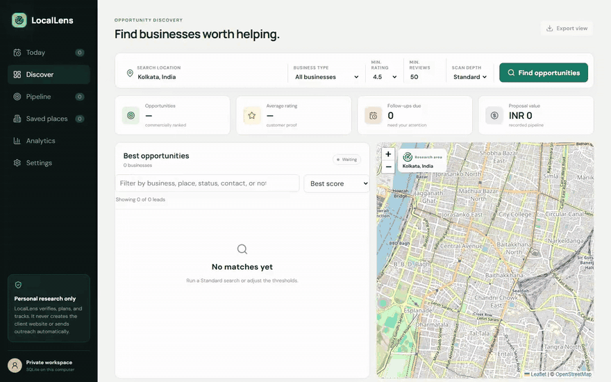
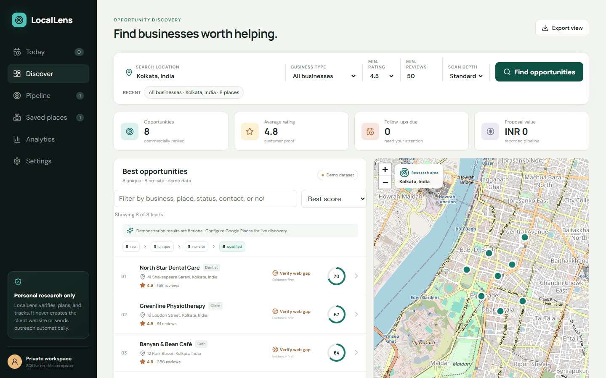
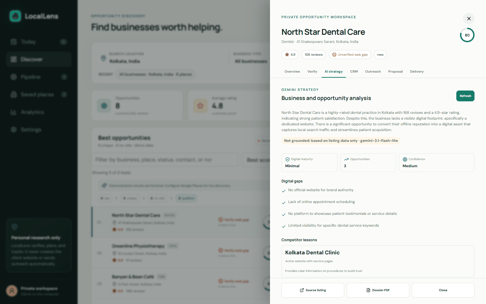
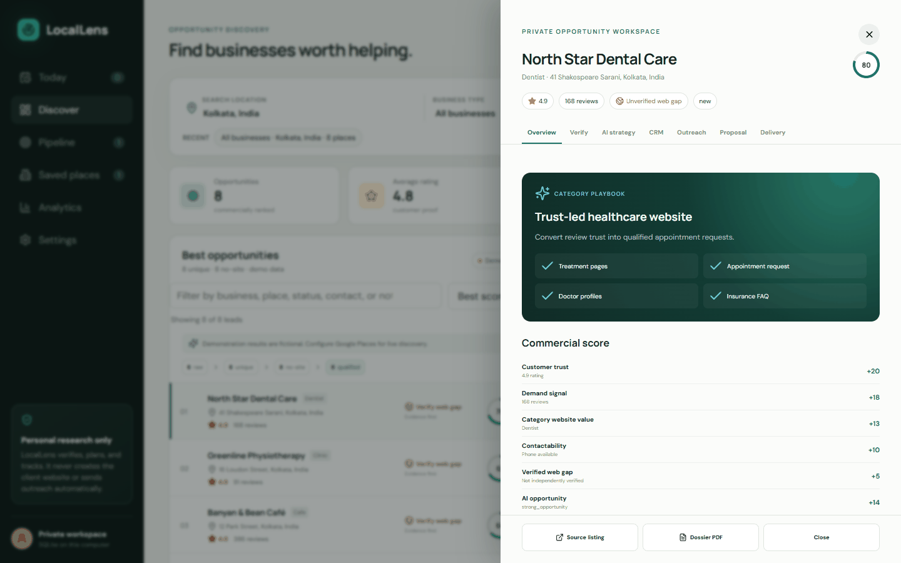
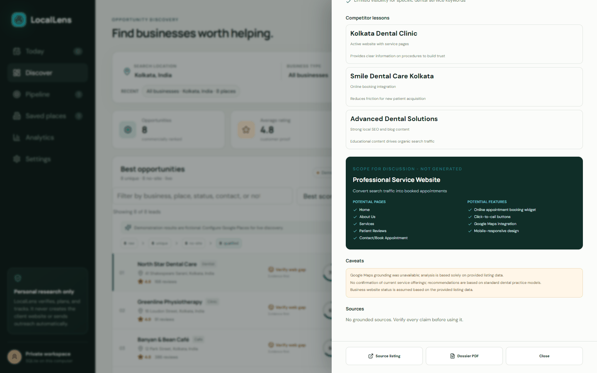
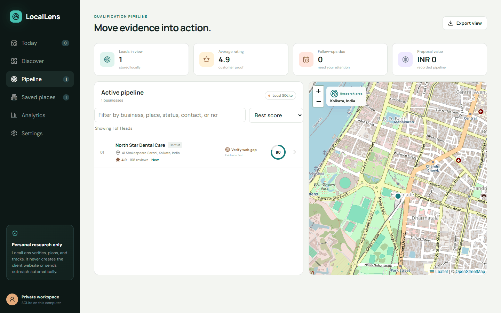
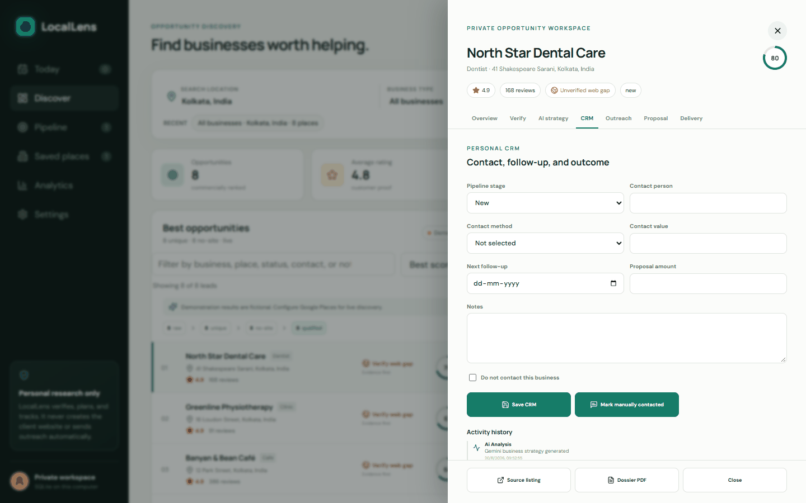
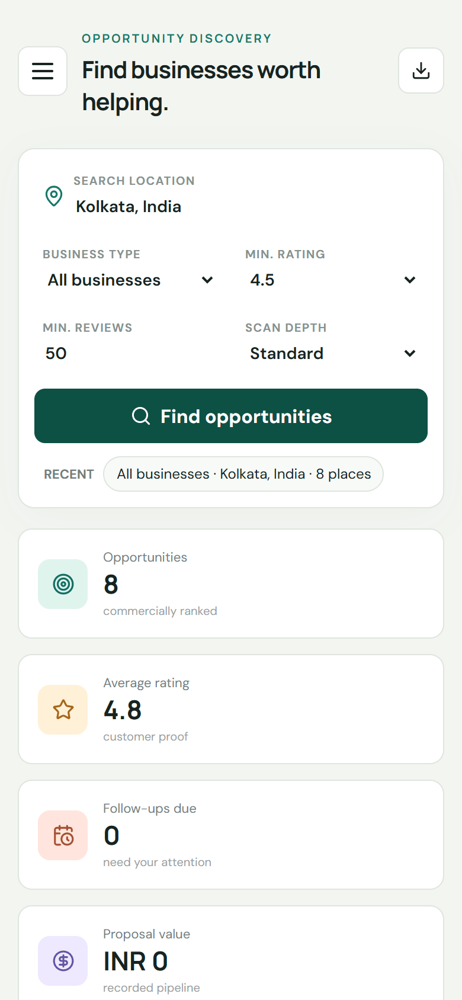

# LocalLens

LocalLens is a private prospect-research and sales-workflow dashboard for finding well-reviewed local businesses whose Google listing does not show an owned website. It helps one operator verify the opportunity, analyze the business, prepare a responsible pitch, manage follow-ups, and track a separately delivered website project.

> LocalLens does not generate, host, or deliver websites. It also does not send email, WhatsApp messages, or calls. Website implementation and every client contact remain manual actions outside the application.

## Demo



Search → ranked opportunities on the map → lead workspace → Gemini strategy brief → pipeline. ([MP4 version](docs/media/demo.mp4))

The recording uses the built-in **demo dataset**: fictional businesses with deliberately invalid phone numbers. The AI brief is a real `gemini-3.1-flash-lite` response. Because the business is fictional, Maps grounding found nothing, and the UI labels the brief as *not grounded* and lists the model's caveats. About 8 seconds of waiting for Gemini were cut from the video, and the cut is labelled on screen.

| Discover | AI strategy brief |
| --- | --- |
|  |  |
| **Lead workspace** | **Caveats, scope, and sources** |
|  |  |
| **Pipeline** | **Personal CRM** |
|  |  |



## Quick start (no API keys needed)

```powershell
npm install
npm run dev
```

Open `http://localhost:5173` and click **Find opportunities**. Without `GOOGLE_PLACES_API_KEY` the search uses the demo dataset, so you can try discovery, scoring, saving, CRM, proposals and the pipeline without spending anything. AI verification, analysis and outreach drafts need a Gemini key (see below).

## How it works

```text
React + Vite UI (src/App.tsx)
        │  /api/* (Vite dev proxy adds the optional API token server-side)
        ▼
Express API (server/index.js) ── SQLite via node:sqlite (server/database.js)
   ├─ server/providers.js   Google Places Text Search (New): query plan, paging, timeouts, dedup by Place ID; demo dataset
   ├─ server/agent.js       qualification rules (rating, reviews, no listed website, operational) + category playbooks
   ├─ server/workflows.js   commercial score, proposal options, delivery checklist, pipeline-stage rules
   ├─ server/gemini.js      two-step Gemini calls: grounded research (Google Maps / Google Search tools),
   │                        then a structured-JSON synthesis against a response schema
   └─ server/pdf.js         spawns scripts/generate_pdf.py (ReportLab) for dossier/proposal PDFs
```

- **Cost control:** identical live searches are cached (24 h by default), and each Places or Gemini call is checked against a local daily ceiling before it runs.
- **Evidence handling:** a missing website field is treated as "not listed", not "no website". The AI prompts forbid inferring a website's absence from that field alone, and the UI shows whether each AI brief was grounded and what its caveats are.
- **Secrets:** API keys are read on the server from `.env`, which is git-ignored, and are never sent to the browser.

## What it includes

- Quick, Standard, and Deep Google Places discovery across useful business categories
- Location, category, rating, and minimum-review filters
- Place-ID deduplication, qualification reasons, rejection diagnostics, and search funnel metrics
- 24-hour search cache plus configurable daily Places and Gemini limits
- Independent website-presence verification with conservative verdicts
- Gemini 3.1 Flash-Lite research and structured opportunity analysis
- Competitor lessons, digital gaps, priority actions, recommended pages, features, and evidence limitations
- Commercial scoring based on reputation, demand, contactability, category value, verified website gap, and AI analysis
- Durable SQLite lead database, activity history, follow-up dates, notes, contact fields, do-not-contact control, and pipeline stages
- Manual-review outreach drafts for email, WhatsApp, phone, follow-up, discovery questions, objections, and claims to avoid
- Editable Starter, Growth, and Booking proposal options with configurable prices
- Client dossier and proposal PDF exports
- External-delivery checklist for work performed after a client agreement
- Today, Discover, Pipeline, Saved, Analytics, and Settings workspaces
- JSON export and timestamped SQLite backup

## Requirements

- Node.js 22.13 or newer (the built-in `node:sqlite` module needs no flag from 22.13; Node 22 still prints an "experimental" warning, which is harmless)
- Python 3.11 or newer with `reportlab`, only for PDF export
- Optional: a Google Places API (New) key for live discovery (demo data is used without one)
- Optional: a Gemini key, set directly or through the existing encrypted NovelForge provider store, for AI features

## Run locally with live providers

```powershell
npm install
python -m pip install reportlab
Copy-Item .env.example .env
npm run dev
```

Open `http://localhost:5173`. The API runs at `http://localhost:8787`.

Set `PDF_PYTHON` in `.env` if the Python installation containing ReportLab is not the default interpreter.

## Provider configuration

### Google Places

Enable Places API (New), put `GOOGLE_PLACES_API_KEY` in `.env`, restrict the key to the API, and set a Cloud quota. LocalLens keeps this key on the server.

- **Quick:** one query and one page; useful for a focused category check.
- **Standard:** up to eight category searches and one page each; the normal daily mode.
- **Deep:** twelve categories and up to two pages per category; broader but more expensive.

The same search is cached for the configured period. The Settings page controls the cache duration and local daily request ceilings. These local ceilings supplement, not replace, Google Cloud quotas.

### Gemini

Credentials resolve in this order:

1. `GEMINI_API_KEY` in this project.
2. The encrypted Gemini provider in NovelForge's local MongoDB, decrypted with NovelForge's existing settings key.

The default model is `gemini-3.1-flash-lite`. The plaintext NovelForge credential is never written into this repository or returned to the browser.

Analysis is evidence-aware: the first step researches the exact business with Google Maps grounding, and the second produces a strict structured assessment. When grounded evidence is weak, the UI preserves the limitation instead of presenting the absence of a source as proof.

## Safe operating model

A missing website field means **not listed on the source profile**, not definite proof that no website exists. Before outreach:

1. Open the Google Maps listing and confirm name, address, phone, and business status.
2. Run website verification and inspect candidate domains/social profiles.
3. Keep uncertain cases in `verification_required`.
4. Run AI analysis, then verify every factual claim and competitor reference.
5. Review and personalize an outreach draft; contact the business manually.
6. Save a proposal as `proposal_draft`. Move it to `proposal_sent` only after you actually deliver it.
7. Record deposits and agreements before starting implementation outside LocalLens.

The do-not-contact flag blocks outreach-draft generation. Proposal text avoids guarantees about ranking, traffic, leads, or revenue. Analytics reports recorded pipeline values, not promised income.

## Data and backups

Operational data is stored in `data/locallens.db`. On first use, the frontend offers a one-time migration of legacy locally saved leads into SQLite. The Settings page can:

- Export all LocalLens data as JSON.
- Create a timestamped database backup under `data/backups/`.
- Configure local API limits, cache time, currency, proposal prices, and default follow-up interval.

The SQLite files, `data/backups/`, and generated `output/pdf/` contents are intentionally excluded from source control.

## Commands

```powershell
npm run dev       # API and Vite development servers
npm run typecheck # Strict TypeScript validation
npm run test      # Node test runner: qualification, scoring, provider, and HTTP API tests
npm run build     # Production frontend build
npm run check     # Typecheck, tests, and production build
npm start         # API only
```

See [PERSONAL_WORKFLOW_GUIDE.md](./PERSONAL_WORKFLOW_GUIDE.md) for the daily operating process, [TESTING_REPORT.md](./TESTING_REPORT.md) for verified evidence, and [OPEN_SOURCE_RESEARCH.md](./OPEN_SOURCE_RESEARCH.md) for the reusable-project research.

## Local access controls

The API listens on `127.0.0.1` by default. Keep that default for a personal workspace.

- Set `HOST` only when you deliberately need another network interface.
- Set `LOCALLENS_ALLOWED_ORIGINS` to a comma-separated list when the frontend uses a non-default origin.
- Set `LOCALLENS_API_TOKEN` to require an `X-LocalLens-Token` header for every API route except the health check. The Vite dev proxy reads the same value from `.env` and adds the header, so the UI and its PDF/JSON download links keep working, and the token never reaches browser code.

Every supported variable is documented in [`.env.example`](./.env.example).

The `test/api.test.js` suite starts the Express app on a random port with a temporary SQLite folder, so it never touches `data/` and makes no Google or Gemini calls.

The workspace also keeps the six most recent searches, including their result counts, so useful location/category combinations can be loaded again. Saved and discovered businesses can be filtered by name, category, address, status, contact details, or CRM notes and sorted by score, rating, review count, or follow-up date. CSV exports include the visible leads plus their CRM contact fields, follow-up dates, and notes for offline work.
